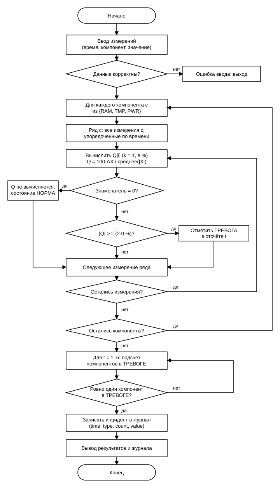

# Курсовой проект: Программа контроля облачной инфраструктуры

## Контрольная точка 1 (КТ1): Пять тестовых значений — формулы и базовый контроль

### Вариант 19

- **Компоненты:** `RAM`, `TMP`, `PWR`
- **Порядок записи во входных данных:** формат `А` (`время компонент значение`), разделитель — пробел.
- **Тип последовательности (6):** у одного компонента на одном отсчёте может быть несколько измерений; все измерения учитываются.
- **Телеметрия за пять отсчётов (одна строка):**
  ```text
  1 TMP 57.4 3 RAM 48.3 2 RAM 47.8 5 PWR 32.6 1 PWR 30.2 2 PWR 29.5 4 TMP 51.4 1 RAM 41.9 3 PWR 34.1 2 TMP 57.7 4 TMP 53.7 2 TMP 55.4 3 TMP 53.4 5 RAM 49.3 4 PWR 33.4 5 TMP 54.8 4 RAM 48.8
  ```
- **Производный показатель $Q$:** симметрированное относительное изменение

  $$Q[i] = 100 \cdot \frac{X[i] - X[i-k]}{\frac{|X[i]| + |X[i-k]|}{2}}$$

  Параметры: $k = 1$, $L = 2.0\%$, $D = 25$.
- **Правило состояния компонента (выход за диапазон):** если $Q < -L$ или $Q > L$, состояние **«ТРЕВОГА»**, иначе **«НОРМА»**.
- **Правило инцидента (ровно один проблемный):** инцидент возникает, если ровно один компонент находится в «ТРЕВОГЕ», а два других — в «НОРМА»:

  $$\text{Incident}(t) = \big(S_{\text{RAM}}[t] \land \lnot S_{\text{TMP}}[t] \land \lnot S_{\text{PWR}}[t]\big) \lor \big(\lnot S_{\text{RAM}}[t] \land S_{\text{TMP}}[t] \land \lnot S_{\text{PWR}}[t]\big) \lor \big(\lnot S_{\text{RAM}}[t] \land \lnot S_{\text{TMP}}[t] \land S_{\text{PWR}}[t]\big)$$

  где $S_{\text{X}}[t] = 1$ — состояние «ТРЕВОГА» компонента $\text{X}$ в отсчёте $t$.
- **Структура Incident:**
  ```c
  typedef struct {
      int time;
      int type;
      int count;
      float value;
  } Incident;
  ```
  Поля: номер отсчёта (`time`), тип инцидента (`type`, 1 — «ровно один проблемный»), число проблемных компонентов (`count`), значение показателя (`value`).

  > Допущение: в `value` записывается значение $Q$ с наибольшим модулем среди проблемных компонентов на данном отсчёте.

> **Допущения КТ1:**
> 1. Формула из карточки записана без множителя 100, но порог $L = 2.0\%$ задан в процентах, поэтому $Q$ считается в процентах (как в примере репозитория). Без множителя $|Q| \le 2$ почти всегда, и правило бы не срабатывало.
> 2. Так как на одном отсчёте может быть несколько измерений одного компонента, ряд компонента формируется из всех его измерений, упорядоченных по времени (внутри одного отсчёта — в порядке записи).
> 3. Компонент считается в «ТРЕВОГЕ» в отсчёте $t$, если хотя бы одно его измерение в этом отсчёте находится в «ТРЕВОГЕ».
> 4. Для первого измерения ряда пары $X[i-k]$ нет, поэтому $Q$ не вычисляется и состояние — «НОРМА». Отсчёт без измерений компонента также считается «НОРМА».
> 5. При делении на ноль $Q$ не вычисляется, точка получает состояние «НОРМА», программа выводит предупреждение.

---

## 1. Алгоритм и блок-схема

### Описание алгоритма

1. Задать массив телеметрии варианта 19 (17 измерений трёх компонентов на отсчётах $t = 1 \dots 5$) и проверить, что время каждого измерения лежит в диапазоне 1..5.
2. Задать параметры: шаг сравнения $k = 1$, порог $L = 2.0\%$.
3. Для каждого компонента (`RAM`, `TMP`, `PWR`) сформировать ряд его измерений, упорядоченный по времени.
4. Для каждого измерения $i \ge k$ вычислить $Q[i]$. Если знаменатель равен нулю, точка получает состояние «НОРМА» и выводится предупреждение.
5. Определить состояние точки: если $|Q[i]| > L$, «ТРЕВОГА», иначе «НОРМА»; для первого измерения ряда — «НОРМА».
6. Перенести тревожные состояния на шкалу отсчётов: компонент в отсчёте $t$ в «ТРЕВОГЕ», если тревожно хотя бы одно его измерение в этом отсчёте.
7. Для каждого отсчёта $t = 1 \dots 5$ подсчитать компоненты в «ТРЕВОГЕ». Если их ровно один, зафиксировать инцидент: номер отсчёта, тип, число проблемных компонентов, значение $Q$.
8. Вывести исходные данные, ряды с $Q$, таблицу состояний и журнал инцидентов.

### Блок-схема алгоритма (КТ1)



---

## 2. Контрольный пример: ручной расчёт

### Исходные данные телеметрии (упорядочены по времени внутри компонента)

| Компонент | Отсчёт $t$: значение (в порядке ряда) |
| :---: | :--- |
| RAM ($X_1$) | 1: 41.9, 2: 47.8, 3: 48.3, 4: 48.8, 5: 49.3 |
| TMP ($X_2$) | 1: 57.4, 2: 57.7, 2: 55.4, 3: 53.4, 4: 51.4, 4: 53.7, 5: 54.8 |
| PWR ($X_3$) | 1: 30.2, 2: 29.5, 3: 34.1, 4: 33.4, 5: 32.6 |

### Ручной расчёт производного показателя $Q$ ($k = 1$)

| Компонент | Отсчёт | Расчёт $Q$ | $Q$, % |
| :---: | :---: | :--- | :---: |
| RAM | $t = 2$ | $100 \cdot \frac{47.8 - 41.9}{(47.8 + 41.9)/2}$ | $+13.15$ |
| RAM | $t = 3$ | $100 \cdot \frac{48.3 - 47.8}{(48.3 + 47.8)/2}$ | $+1.04$ |
| RAM | $t = 4$ | $100 \cdot \frac{48.8 - 48.3}{(48.8 + 48.3)/2}$ | $+1.03$ |
| RAM | $t = 5$ | $100 \cdot \frac{49.3 - 48.8}{(49.3 + 48.8)/2}$ | $+1.02$ |
| TMP | $t = 2$ | $100 \cdot \frac{57.7 - 57.4}{(57.7 + 57.4)/2}$ | $+0.52$ |
| TMP | $t = 2$ | $100 \cdot \frac{55.4 - 57.7}{(55.4 + 57.7)/2}$ | $-4.07$ |
| TMP | $t = 3$ | $100 \cdot \frac{53.4 - 55.4}{(53.4 + 55.4)/2}$ | $-3.68$ |
| TMP | $t = 4$ | $100 \cdot \frac{51.4 - 53.4}{(51.4 + 53.4)/2}$ | $-3.82$ |
| TMP | $t = 4$ | $100 \cdot \frac{53.7 - 51.4}{(53.7 + 51.4)/2}$ | $+4.38$ |
| TMP | $t = 5$ | $100 \cdot \frac{54.8 - 53.7}{(54.8 + 53.7)/2}$ | $+2.03$ |
| PWR | $t = 2$ | $100 \cdot \frac{29.5 - 30.2}{(29.5 + 30.2)/2}$ | $-2.35$ |
| PWR | $t = 3$ | $100 \cdot \frac{34.1 - 29.5}{(34.1 + 29.5)/2}$ | $+14.47$ |
| PWR | $t = 4$ | $100 \cdot \frac{33.4 - 34.1}{(33.4 + 34.1)/2}$ | $-2.07$ |
| PWR | $t = 5$ | $100 \cdot \frac{32.6 - 33.4}{(32.6 + 33.4)/2}$ | $-2.42$ |

### Определение состояний и инцидентов ($L = 2.0\%$)

| Отсчёт ($t$) | Статус RAM | Статус TMP | Статус PWR | Проблемных | Инцидент |
| :---: | :---: | :---: | :---: | :---: | :---: |
| 1 | НОРМА | НОРМА | НОРМА | 0 | Нет |
| 2 | **ТРЕВОГА** ($+13.15$) | **ТРЕВОГА** ($-4.07$) | **ТРЕВОГА** ($-2.35$) | 3 | Нет (не один) |
| 3 | НОРМА | **ТРЕВОГА** ($-3.68$) | **ТРЕВОГА** ($+14.47$) | 2 | Нет (не один) |
| 4 | НОРМА | **ТРЕВОГА** ($+4.38$) | **ТРЕВОГА** ($-2.07$) | 2 | Нет (не один) |
| 5 | НОРМА | **ТРЕВОГА** ($+2.03$) | **ТРЕВОГА** ($-2.42$) | 2 | Нет (не один) |

Ожидаемый результат: **инцидентов нет**, так как ни на одном отсчёте не выполняется правило «ровно один проблемный компонент».

---

## 3. Реализация программы

Исходный код программы: [Source.c](Source.c)

Особенности реализации:

- структура программы повторяет шаблон: один `main`, константы через `#define`, массивы значений, времени и состояний, структура `Incident`, вывод через `printf`;
- измерения записаны в порядке времени; несколько измерений одного компонента на одном отсчёте выводятся в одной ячейке через «; »;
- расчёт $Q$ выполняется для каждого измерения относительно предыдущего измерения того же компонента, при нулевом знаменателе точка пропускается;
- тревожные состояния переносятся на шкалу отсчётов; для отсчёта, где несколько измерений в тревоге, записывается $Q$ с наибольшим модулем;
- выравнивание столбцов выполняется по числу напечатанных символов, поэтому таблицы ровные;
- файл сохранён в UTF-8.

Сборка: `gcc -std=c99 -Wall -Wextra -pedantic Source.c -o kt1 -lm`

---

## 4. Результаты работы программы

Вывод программы в консоли:

```text
Контроль облачной инфраструктуры (Вариант 19, КТ1)

Исходные данные телеметрии:
Отсчет  RAM             TMP             PWR             
1       41.9            57.4            30.2            
2       47.8            57.7; 55.4      29.5            
3       48.3            53.4            34.1            
4       48.8            51.4; 53.7      33.4            
5       49.3            54.8            32.6            

Симметрированное относительное изменение Q (%) при k = 1:
Отсчет  Q(RAM)          Q(TMP)          Q(PWR)          
2       +13.15          +0.52; -4.07    -2.35           
3       +1.04           -3.68           +14.47          
4       +1.03           -3.82; +4.38    -2.07           
5       +1.02           +2.03           -2.42           

Состояние компонентов (порог L = 2.0%):
Отсчет  RAM             TMP             PWR             
1       НОРМА           НОРМА           НОРМА           
2       ТРЕВОГА         ТРЕВОГА         ТРЕВОГА         
3       НОРМА           ТРЕВОГА         ТРЕВОГА         
4       НОРМА           ТРЕВОГА         ТРЕВОГА         
5       НОРМА           ТРЕВОГА         ТРЕВОГА         

Журнал инцидентов (ровно один компонент в тревоге):
Инцидентов не обнаружено.
```

Вывод программы полностью совпадает с ручным контрольным расчётом.

---

## 5. Вывод

В ходе выполнения контрольной точки 1 реализован расчёт симметрированного относительного изменения $Q$ для трёх компонентов с учётом нескольких измерений на одном отсчёте. Состояния компонентов определяются по порогу $L = 2.0\%$, инциденты выявляются по правилу «ровно один проблемный компонент». На тестовом наборе варианта 19 инцидентов нет; результат программы совпадает с ручным расчётом.

---

## 6. Информация о разработчике

- **Студент:** Кочанов Кирилл Романович
- **Группа:** БОТИ-261
- **Год:** 2026
